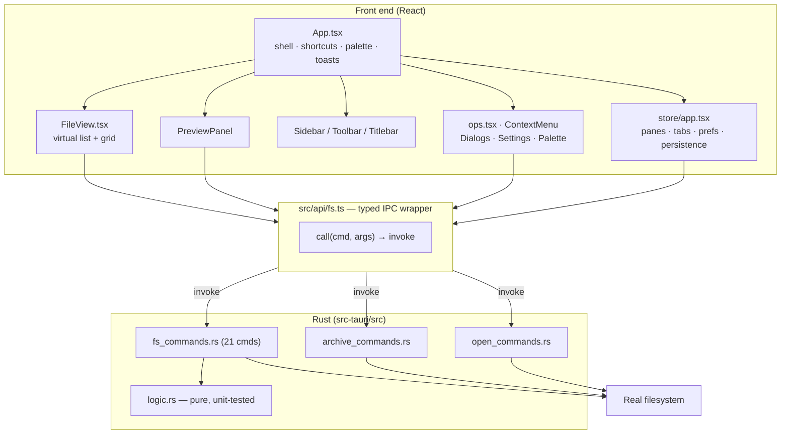

# Fily — Handoff for the Next AI Agent

Prepared: 2026-10-10. Read this before touching the project.

Every claim below is tagged **[V]** verified by direct inspection/command output,
**[I]** inferred, or **[U]** unknown. Commands and their real output are recorded
in §D and §B. Do not trust the older `README.md`/`PROGRESS.md` blindly — both
contain stale claims, catalogued in §G.

---

## A. Project Overview

**Fily** is a desktop file manager for Linux/Windows built as a local-first
alternative to Nautilus. Tauri 2 shell + React 18 + TypeScript front end, with
**all** filesystem work done in audited Rust commands. There is no mock data and
no fake feature anywhere in the product **[V]**.

Core product goals, taken from [`RESEARCH.md`](RESEARCH.md) (pre-product
research comparing Files/Finder/Dolphin/Nautilus/Opus):

1. **Conflict-first copy/move** — never silently overwrite.
2. **Trash by default**, permanent delete behind explicit confirm, protected
   paths refused *in the backend*, not merely hidden in the UI.
3. **Virtualized list + capped previews** — bounded cost regardless of directory size.
4. **Honest search** — filename search with `type:` / `ext:` / `size:` filters,
   bounded and debounced. No fake "full-text" claims.
5. **Command palette + full shortcut map** (Raycast lesson).
6. **Neutral canvas, one accent.** No glass, no card soup.
7. **Dual pane + tabs shipped early** (Dolphin/Opus users call them non-negotiable).

**Stage:** feature-complete v1, built and installed locally, 0.1.0, no release
tagging or publishing configured **[V]**. See §I for version-control status.

**Stack [V]:**

| Layer | Choice | Version seen |
|---|---|---|
| Shell | Tauri | tauri-cli 2.12.1 |
| UI | React + TypeScript | 18.3.1 / TS ~5.6.2 |
| Bundler | Vite | ^6.0.3 |
| Tests | vitest | ^2.1.5 |
| Backend | Rust | rustc/cargo 1.98.1 |
| JS runtime | Node | v24.16.0 |

Runtime deps are deliberately few: `@tauri-apps/api`, `@tauri-apps/plugin-dialog`,
`react`, `react-dom`, `lucide-react` **[V]**. Rust deps: `tauri`,
`tauri-plugin-dialog`, `serde`, `serde_json`, `walkdir`, `trash`, `mime_guess`,
`sha2`, `dirs`, `chrono`, `base64`, `zip` **[V]**.

> Note: `lucide-react` is **still used** for UI chrome (chevrons, folder icons,
> menu items) across 9 components. Only *per-file-type* icons were replaced by the
> authored `Glyph.tsx` set. Do not "remove the unused dependency" — it is used.

---

## B. Current State

### Verified green as of this handoff

| Check | Command | Result |
|---|---|---|
| Type check | `npx tsc --noEmit` | clean, no output **[V]** |
| Production build | `npm run build` | ✓ built in ~1.4s; JS 277.79 kB (gzip 82.22), CSS 32.72 kB (gzip 7.22) **[V]** |
| Unit tests (TS) | `npx vitest run` | **8 passed / 8** **[V]** |
| Unit tests (Rust, full) | `cargo test --manifest-path src-tauri/Cargo.toml` | **15 passed / 15** **[V]** |
| Unit tests (Rust, no GUI deps) | `rustc --edition 2021 --test src-tauri/src/logic.rs -o /tmp/logic_test && /tmp/logic_test` | **6 passed / 6** **[V]** |
| Config suite | `node /tmp/opencode/fily/configtest.mjs …` | **4/4** **[V]** |
| Rust formatting | `rustfmt --check --edition 2021 src-tauri/src/*.rs` | exit 0, clean **[V]** |
| Functional UI suite | `node /tmp/opencode/fily/test-ui.mjs http://127.0.0.1:1429/ /tmp/opencode/fily/ui` | **27/27** **[V]** |
| Scale/virtualization suite | `node /tmp/opencode/fily/gaptest.mjs …` | **7/7** **[V]** |
| Thumbnail suite | `node /tmp/opencode/fily/thumbtest.mjs …` | **4/4** **[V]** |
| Release build | `npx tauri build` | deb 3,917,572 B (3.74 MiB), rpm 3,917,508 B, AppImage 115,628,536 B (110.27 MiB), zero warnings **[V]** |
| Install parity | `md5sum ~/.local/bin/fily src-tauri/target/release/fily` | identical (`9fb82d80…`) **[V]** |

### What exists and is believed working

- 26 registered Tauri commands ([`src-tauri/src/main.rs`](src-tauri/src/main.rs)) **[V]**.
- Backend safety: `valid_path` (absolute + NUL rejection),
  `is_protected_target` used by both destructive ops
  ([`fs_commands.rs:536`](src-tauri/src/fs_commands.rs), [`:574`](src-tauri/src/fs_commands.rs)),
  zip-slip refusal ([`:804-817`](src-tauri/src/fs_commands.rs)) **[V]**.
- Search bounded by generation-token supersede, 200-char query clamp,
  300,000-entry walk budget, max 5,000 results ([`:654-679`](src-tauri/src/fs_commands.rs)) **[V]**.
- Preview caps: text 256 KB, image 12 MB ([`:704-705`](src-tauri/src/fs_commands.rs)) **[V]**.
- Frontend: virtualized list + incremental grid, tabs, dual pane, selection,
  inline rename, bulk rename, context menus, drag-and-drop, preview panel,
  command palette, 9 themes, settings modal, custom titlebar, resizable sidebar **[V]**.

### Partial / unverified

- **Window drag & minimize** — proven only at the IPC layer. A compositing
  window manager is required to complete a move; close was proven live **[V]
  (see [`PROGRESS.md`](PROGRESS.md) "Known issues")**.
- **Windows code paths** (Recycle Bin, `cmd /C start`, drive roots) — implemented,
  never executed; no Windows host available **[V]**.
- **Trash restore** — OS viewer only, no in-app UI **[V]**.
- Audio/video preview is metadata + system-player handoff by design; no in-app
  media decoding **[V]**.

### Technical debt / gaps found during this inspection

1. **All test harnesses live outside the repo** in `/tmp/opencode/fily/` — 14
   `.mjs` files **[V]**. `/tmp` is ephemeral; these vanish on reboot or tmpfs
   cleanup. See §F task 1.
2. **`tests/` is not type-checked.** `tsconfig.json` has `"include": ["src"]`,
   and `tsc --noEmit --listFilesOnly | grep -c tests/` returns `0` **[V]**.
   `npm run lint` is just `tsc --noEmit`, so a broken test file passes silently.
3. **No ESLint installed or configured** **[V]**. The
   `// eslint-disable-next-line react-hooks/exhaustive-deps` comments in
   `FileView.tsx` and `store/app.tsx` are inert intent markers, not enforced.
4. **No CI** — no `.github/` directory **[V]**. Every gate is manual.
5. **No version-control baseline for any source file** — HEAD is `c3961e8`
   ("Initial commit") but it contains **only `LICENSE`**; all 56 source files are
   still untracked, so there is nothing to diff or roll back to (§I) **[V]**.
6. **Orphaned localStorage key**: profiles written before Round 12 still carry
   `fily.iconSize`, which no longer has a reader (grep for `iconSize` → no
   matches) **[V]**. Harmless dead data.
7. **Settings dialog "Done" button** was clipped above 130% app zoom; fixed by
   `calc(100vh / var(--zoom))` **[V]** — re-verify at extreme zoom if touched.

---

## C. Architecture and Codebase Map

Two processes: a Rust backend exposing commands over Tauri IPC, and a React SPA
that never touches the filesystem directly.



### Entry points and initialization

- [`index.html`](index.html) → [`src/main.tsx`](src/main.tsx). `main.tsx` sets
  `document.documentElement.dataset.theme` from `localStorage` **before** React
  mounts, so there is no light-theme flash **[V]**.
- [`src/App.tsx`](src/App.tsx) is the shell: pane layout, global key handler,
  command palette registry, toast queue.
- [`src-tauri/src/main.rs`](src-tauri/src/main.rs) registers the 26 commands and
  sets the window title to "Fily" in `setup`.

### Directory responsibilities

| Path | Responsibility |
|---|---|
| [`src/store/app.tsx`](src/store/app.tsx) | Single React context store. Pane/tab state, history, prefs, clipboard, toasts, and **all** `localStorage` persistence. Read this before adding any setting. |
| [`src/api/fs.ts`](src/api/fs.ts) | Typed wrapper over Tauri `invoke`; converts thrown errors into friendly messages. All FS access funnels through here. Also exposes `getSettings`/`setSettings`/`resetSettings` and `onSettingsChanged`. |
| [`src-tauri/src/settings.rs`](src-tauri/src/settings.rs) | Authoritative settings store: JSON file, clamping, validation, atomic write, watcher fingerprint. |
| [`src-tauri/src/cli.rs`](src-tauri/src/cli.rs) | `fily config …` subcommands. Parsed before the Tauri builder so config never opens a window. |
| [`src/components/FileView.tsx`](src/components/FileView.tsx) | The heaviest component (633 lines). Virtualized list, incremental grid, scroll memory, keyboard nav, inline rename, thumbnails. |
| [`src/components/ops.tsx`](src/components/ops.tsx) | Context-menu builder. Items and icons vary by selection kind (file vs folder vs mixed). |
| [`src/components/Glyph.tsx`](src/components/Glyph.tsx) | Authored **filled** SVG icon set. Exists because Lucide is stroke-only and could not be filled. |
| [`src/components/ExtIcon.tsx`](src/components/ExtIcon.tsx) | extension → glyph + color map. |
| [`src/utils/thumb.ts`](src/utils/thumb.ts) | Canvas downscale for thumbnails (see §E). |
| [`src/utils/search.ts`](src/utils/search.ts) | `type:` / `ext:` / `size:` query parser. Unit-tested. |
| [`src/styles/tokens.css`](src/styles/tokens.css) | Design tokens, 9 themes, reduced-motion block. |
| [`src/styles/app.css`](src/styles/app.css) | Component CSS. |

### Where to look per task

| Task | Start here |
|---|---|
| New FS operation | `fs_commands.rs` (add `#[tauri::command]`) → `main.rs` handler list → `api/fs.ts` → caller |
| New setting | `store/app.tsx` state + `localStorage.setItem` + the reset-all key list (~line 280) |
| Row/list layout change | `FileView.tsx` constants **and** `tokens.css --row-h` (they must match, see below) |
| Menu item | `ops.tsx` |
| Theme | `themes.ts` + `tokens.css` |
| Icon/color for a file type | `ExtIcon.tsx` |

### Critical cross-file invariant

`ROW_H = 34` in [`FileView.tsx:10`](src/components/FileView.tsx) **must** equal
`--row-h: 34px` in [`tokens.css:30`](src/styles/tokens.css), which
[`app.css:462`](src/styles/app.css) applies as row `height`. The CSS carries an
explicit comment: the pitch must match *exactly*, with padding rather than
margins, because sibling margins collapse and break the virtualizer's arithmetic **[V]**.

### Persistence keys (all `localStorage`) **[V]**

Since Round 14 the **authoritative** store is `~/.config/fily/settings.json`; `localStorage` remains a fast boot cache and is migrated up on first run.

legacy/other `localStorage` keys: `fily.theme`, `fily.prefs` (per-directory), `fily.hidden`, `fily.listScale`,
`fily.uiZoom`, `fily.sideWidth`, `fily.toolbar`, `fily.side.devices`,
`fily.side.places`, `fily.bookmarks`, `fily.devices`(served). Adding a setting
means touching all three places: load, set, and the reset-all array.

### Two coordinate spaces in the scaled list (regression risk)

The list content is scaled with CSS `zoom` on an inner `.file-canvas`, while the
scroll container sits outside it. Therefore:

- `scrollTop` / `viewportH` (measured on the container) are **visual** pixels →
  drive `rowPx = ROW_H * app.listScale`.
- Padding elements live **inside** the canvas, so their CSS heights must be
  **unscaled** (`start * ROW_H`).

Getting this backwards produces a blank gap above row 1 and a scrollbar
quadratically too long. This exact bug was shipped and fixed in Round 13; there
is now a regression test for it (§F task 2).

---

## D. Development Environment and Commands

### Prerequisites (all confirmed present on this machine **[V]**)

| Tool | Version / note |
|---|---|
| Node | v24.16.0 |
| npm | 11.13.0 |
| rustc / cargo | 1.98.1 |
| tauri-cli | 2.12.1 (`npx tauri --version`) |
| `webkit2gtk-4.1` | **2.54.1-1** installed |

> Arch caveat that cost real time: the WebKit package is named
> **`webkit2gtk-4.1`**, not `webkit2gtk`. It is currently installed and working;
> `README.md`'s claim that WebKit is "not available on this machine" is **stale
> and wrong** **[V]**.

### Commands

```sh
npm install

npm run dev          # Vite on :1420 (frontend only — no Rust backend)
npx tauri dev        # full desktop app with hot reload

npm run lint         # == tsc --noEmit
npm run build        # tsc --noEmit && vite build
npm test             # vitest run  (8 tests)

npx tauri build      # release bundles into src-tauri/target/release/bundle/

# Rust tests
cargo test --manifest-path src-tauri/Cargo.toml                       # 15, uses the crate's deps
rustc --edition 2021 --test src-tauri/src/logic.rs -o /tmp/logic_test && /tmp/logic_test  # 6, no GUI deps
rustfmt --check --edition 2021 src-tauri/src/*.rs

# Configure without the GUI (runs before the window opens; applies live)
./src-tauri/target/release/fily config list
./src-tauri/target/release/fily config set theme=nord uiZoom=1.2
```

### Frontend-only functional testing (harness)

The headless Chromium suites need the built `dist/` served on port **1429**:

```sh
cd /home/mochibunr/Fily
python3 -m http.server 1429 --directory dist &     # already running (pid 112111)

node /tmp/opencode/fily/test-ui.mjs  "http://127.0.0.1:1429/" /tmp/opencode/fily/ui
node /tmp/opencode/fily/gaptest.mjs "http://127.0.0.1:1429/" /tmp/opencode/fily/gap.png
node /tmp/opencode/fily/thumbtest.mjs "http://127.0.0.1:1429/" /tmp/opencode/fily/th.png
node /tmp/opencode/fily/configtest.mjs "http://127.0.0.1:1429/" /tmp/opencode/fily/cfg.png
```

They drive Chromium over raw CDP with a **stubbed IPC bridge**
(`window.__TAURI_INTERNALS__.invoke`), so they test the React layer without Rust.
Two other probes exist for geometry work: `zoomfix.mjs`, `zoomclip.mjs`; plus
one-shot debug scripts `dbg.mjs`, `diag.mjs`, `probe.mjs`, `repro.mjs`, `hit.mjs`,
`dragprobe.mjs`, `ipc.mjs`, `glyphprobe.mjs`, `filemenu.mjs`, `shoot.mjs` **[V]**.

### Installing over a running instance

`cp` into `~/.local/bin/fily` fails with **"Text file busy"** while the app runs.
Use rename-over:

```sh
cd /home/mochibunr/Fily
cp src-tauri/target/release/fily /tmp/fily.new && mv -f /tmp/fily.new ~/.local/bin/fily
```

The user must then restart the app. **The next agent must be told:** never
combine a `pkill -f "<pattern>"` with a command line that also contains that
literal pattern — the shell matches and kills itself (this happened twice,
producing `Killed by SIGTERM` with no other output). Use bracketed patterns
(`[f]ily`) *and* keep the kill in its own invocation.

### Environment variables

None required — no API keys, no secrets, no `.env` **[V]**. Configuration is
`src-tauri/tauri.conf.json` (`csp: null`, `transparent: true`,
`decorations: false`, bundle targets `all`).

### Verified under Xvfb

Headless runs use `Xvfb :99` + `picom --backend xrender --config /dev/null`.
**picom is required** for the `transparent: true` window to blend; under bare
Xvfb you get black/offset artifacts that are *not* app bugs **[V]**. Use
`HOME=/tmp/opencode/fily/fakehome` for an isolated profile.

---

## E. Implementation Status by Feature

Status vocabulary: **Complete (verified)**, **Partial**, **Unverified**, **Broken**.

### Filesystem backend — Complete (verified)

26 commands in [`src-tauri/src/main.rs`](src-tauri/src/main.rs) **[V]**:
`list_dir`, `stat_path`, `create_dir`, `create_file`, `rename_path`, `copy_paths`,
`move_paths`, `duplicate_path`, `trash_paths`, `delete_permanent`, `search_dir`,
`read_text_preview`, `read_image_data_url`, `list_archive`, `file_checksum`,
`dir_size`, `open_path`, `open_terminal`, `get_places`, `get_volumes`,
`extract_archive`, `compress_zip`, `extract_here`, `get_openers`, `open_with`.

Safety guarantees, each with a source location **[V]**:

| Guarantee | Where |
|---|---|
| Absolute-path + NUL validation | `fs_commands.rs:99` `valid_path` |
| Protected-target refusal on destructive ops | `:151` `is_protected_target`, used at `:536`, `:574` |
| Zip-slip refusal (`..` / absolute) | `:804-817` |
| No shell string interpolation | `open_commands.rs` uses argv-based spawn **[I]** — worth a read to confirm |
| Cross-device move fallback | `move_paths`; copy+delete+report **[I]** — not re-verified this pass |

`logic.rs` holds pure helpers (`split_stem_ext`, `strip_copy_suffix`,
`keep_both_name`, `is_protected`, `name_matches`, `is_valid_entry_name`) with 6
unit tests, kept Tauri-free on purpose so `rustc --test` works without GTK **[V]**.

### Frontend shell — Complete (verified via harness)

Titlebar, toolbar, breadcrumbs, tabs, dual pane, sidebar, status bar, toasts,
dialogs, palette. 27/27 functional checks **[V]**.

### List virtualization — Complete (verified)

Window = one screenful + 14-row lead / +40 trailing buffer. `FileRow` is
`React.memo`'d. Scroll throttled with `requestAnimationFrame`. Grid renders in
`GRID_BATCH = 120` increments behind an `IntersectionObserver` **[V]**.
Constants: `ROW_H = 34`, `GRID_BATCH = 120`, `THUMB_CACHE_MAX = 150`,
`THUMB_CONCURRENCY = 4` ([`FileView.tsx:10-13`](src/components/FileView.tsx)).

Per-directory scroll memory capped at 100 entries **[V]**.

### Thumbnails — Complete (verified, 4/4)

Image files show a real downscaled preview in **both** list and grid. Design
rationale worth preserving: `read_image_data_url` returns raw bytes base64-encoded,
which is fine for the large preview panel but would put an ~8 MB string in memory
per photo in a list. Instead [`utils/thumb.ts`](src/utils/thumb.ts) decodes and
downscales **in the webview** via canvas (72 px in list, 160 px in grid) and caches
only the small PNG. Thumbnails load **only for mounted rows** (grid batch or
current list window), tracked by a cheap `mountedKey` string so scrolling retargets
the loader without re-firing every frame.

> This deliberately avoids adding the `image` Rust crate, which would have grown
> the 3.74 MiB binary. **Do not "optimize" this by adding `image`** without
> re-measuring bundle size and RAM.

### Scaling (app + list) — Complete (verified)

- **App size** (`uiZoom`, 0.7–1.6): CSS `zoom` on `document.documentElement`,
  set together with a `--zoom` custom property. Ctrl+`+`/`-`/`0`.
- **List size** (`listScale`, 0.8–1.6): CSS `zoom` on `.file-canvas`.
  Ctrl+Wheel over the list/grid.

`100vh` does **not** account for CSS `zoom`, so
`html, body, #root { height: calc(100vh / var(--zoom, 1)) }` is mandatory;
without it the layout overflows and pushes chrome off-screen **[V]**.

### Themes — Complete (verified)

9 themes (`light`, `dark`, `dracula`, `catppuccin-mocha`, `catppuccin-latte`,
`nord`, `gruvbox`, `tokyo-night`, `one-dark`) in [`themes.ts`](src/themes.ts) +
[`tokens.css`](src/styles/tokens.css) **[V]**. `prefers-reduced-motion` is honored
in `tokens.css:358` **[V]**.

### Search — Complete (verified)

Recursive filename search, debounced, bounded. Superseded scans abort via an
atomic generation counter; 300k walk budget; 200-char clamp; max 5,000 results,
depth 8 **[V]**.

### CLI / external configuration — Complete (verified, with one gap)

Added Round 14 so an AI agent or script can configure the app. See
[`src-tauri/src/settings.rs`](src-tauri/src/settings.rs) and
[`src-tauri/src/cli.rs`](src-tauri/src/cli.rs).

- `fily config list|get|set|reset|path`, parsed in `main()` **before** the Tauri
  builder so a config command never opens a window.
- Store is `~/.config/fily/settings.json`; `FILY_CONFIG_DIR` overrides it.
  Writes are atomic (temp + rename) so a watcher never sees a half-written file.
- Every field is clamped on write *and* re-clamped on read, and unknown keys are
  rejected rather than ignored — a typo fails loudly instead of silently
  no-opping.
- A background thread polls a (mtime, len) fingerprint every 400 ms and emits
  `settings-changed`; `store/app.tsx` subscribes and applies without restart.
- The store also writes through on every in-app change, so the file is always
  current no matter which side made the change.
- On first run the file does not exist, so existing `localStorage` values are
  migrated up and nothing is lost.

**Verified [V]:** 15/15 Rust tests (round-trip persistence, corrupt-file
fallback, clamping, CLI typing), 4/4 config suite (file beats stale
`localStorage`, write-through payload, correct event name subscribed), CLI error
messages and clamping exercised by hand against an isolated `HOME`.

> **Known gap [U]:** the *live* re-theme of a real running window was **not**
> visually confirmed. The binary maps no X window under Xvfb without a window
> manager (`xdotool search` returns nothing), so screenshots of the real app are
> impossible in this environment. The Rust watcher, the event emission, the
> subscription, and the apply path are each verified separately; only the
> framework-provided hop between the Rust emitter and the webview is untested.

### Not implemented (deliberately, per `RESEARCH.md`)

- Indexed / full-text search — filename search only, **by design**.
- Archive browsing-as-filesystem — list + extract only.
- Duplicate-finder review UI — backend checksum/size primitives exist; UI deferred.
- Custom shortcut remapping — deferred, documented.
- In-app Trash restore — OS viewer only.

---

## F. Immediate Priorities and Next Steps

### 🔴 Urgent — protect against data loss

**1. Move the test harness into the repository.**
- *Outcome:* harnesses survive reboot/tmpfs cleanup.
- *Why:* all 14 scripts live in `/tmp/opencode/fily/` **[V]**. `gaptest.mjs` is
  the **only** guard against the Round 13 regression; losing it means the scaled-list
  bug can silently return.
- *Inspect:* `/tmp/opencode/fily/*.mjs`.
- *Blockers:* none.
- *Accept:* scripts committed under e.g. `tests/harness/`, `README` line added
  explaining the `python3 -m http.server 1429 --directory dist` prerequisite, and
  `npm run test:ui` style scripts added to `package.json`.
- *Validate:* run all three suites from their new location, expect 27/27, 7/7, 4/4.

**2. Add a regression test for list row pitch.**
- *Outcome:* a test asserts `ROW_H` equals the computed `.file-row` height, so a
  future CSS/TS divergence fails loudly.
- *Why:* this mismatch silently breaks virtualization; the app only notices on
  scaled lists.
- *Inspect:* `FileView.tsx:10`, `tokens.css:30`, `app.css:462`.
- *Accept:* test fails when `--row-h` is changed without `ROW_H`.

**3. Bring `tests/` under type checking.**
- *Outcome:* `npm run lint` covers test files.
- *Why:* `tsconfig.json` `include` is `["src"]`; test files are unchecked **[V]**.
- *Accept:* `tsc --noEmit` reports errors in `tests/`; `npm run lint` still clean.

### 🟡 High priority

**4. Exercise destructive paths in the installed app.**
- *Outcome:* confidence in the highest-risk code.
- *Why:* copy/move conflicts, Trash, and zip-extract have never been run
  end-to-end in the real binary **[V]** (`PROGRESS.md` next steps #1).
- *Inspect:* `fs_commands.rs` conflict pre-flight; `Dialogs.tsx` conflict UI.
- *Accept:* a conflict produces Replace/Keep both/Skip exactly once; a
  protected path is refused by the backend even if invoked directly over IPC.
- *Validate:* manual pass in the installed app under Xvfb + screenshots.

**5. Commit the source — and do not push before this lands.**
- *Outcome:* a real baseline exists so changes are diffable and recoverable, and
  the GitHub repo is not empty.
- *Why:* HEAD `c3961e8` is named "Initial commit" but contains **only `LICENSE`**;
  all 56 source files remain untracked (§I) **[V]**. A push right now would
  publish an empty repository. MIT `LICENSE` is already in place.
- *Inspect:* §I; decide whether `src-tauri/gen/` (312 KB of Tauri-generated
  schemas, which Tauri's own template gitignores) should be excluded.
- *Blockers:* copy the harnesses out of `/tmp` first (task 1).
- *Accept:* `git ls-files | wc -l` ≥ 56; `git ls-tree -r --name-only HEAD` lists
  `src/App.tsx` and `src-tauri/src/main.rs`; `node_modules/`, `dist/`,
  `src-tauri/target/` absent from `git ls-files`.
- *Note:* `origin` is already configured to `https://github.com/mochibunr/Fily.git`,
  so a mistimed `git push -u` is a one-command mistake.

**6. Confirm live CLI re-configuration on a real desktop session.**
- *Outcome:* `fily config set theme=nord` visibly re-themes an already-open window.
- *Why:* every link is verified separately (watcher, emitter, subscription,
  apply), but the binary maps **no X window** under Xvfb without a WM
  (`xdotool search` returns nothing), so the end-to-end visual hop is untested **[V]
  — see the Known gap note in §E**.
- *Inspect:* `src-tauri/src/main.rs` watcher, `store/app.tsx` subscription.
- *Accept:* user runs `fily config set theme=nord` with Fily open and reports the
  window changed without a restart.

**7. Confirm window drag/minimize on a real desktop session.**
- *Outcome:* a user-confirmed answer.
- *Why:* cannot be completed headless — needs a compositor/WM **[V]**.
- *Accept:* user reports dragging and minimizing work on KDE Plasma.

### 🟢 Later

8. In-app Trash restore UI (`trash::os_limited::list`).
9. Duplicate-finder review UI over existing checksum/size commands.
10. Windows smoke test (Recycle Bin, drive roots, `cmd /C start`).
11. Consider a real linter (ESLint is entirely absent; disable-comments are inert **[V]**).
12. Consider CI (none exists **[V]**) running the three gates in §D.
13. Add screenshots under `docs/` for the published README (none exist yet).

---

## G. Known Bugs and Investigation Notes

### Resolved — keep the reasoning, these are easy to reintroduce

**Scaled list showed a huge blank gap above row 1 (user-reported, screenshot).**
- *Symptom:* after Ctrl+Wheel scaling, ~78 rows' worth of dead space between the
  column header and the first row; scrollbar ~21% too long.
- *Root cause (verified by measurement):* pad elements were computed in **scaled**
  px (`start * ROW_H * scale`) but live **inside** the zoomed `.file-canvas`,
  which multiplies by scale a second time — quadratic growth **[V]**.
- *Fix:* pads stay in unscaled px; `rowPx` (scaled) is used only to pick the window.
- *Verification:* `gaptest.mjs` — gap 0 px, scroll height 25538 vs ~25543 expected
  (0.0% off), row under header = 70 at scrollTop 3000, seams 0 px **[V]**.

**Settings button and Settings-dialog "Done" clipped at >130% app zoom (user-reported).**
- *Symptom:* `sidebarBottom` 810 in a 640 px window at 1.3; 997 at 1.6 **[V]**.
- *Two distinct causes:** (a) the sidebar footer used a flex spacer that collapsed
  to zero height under zoom → replaced with `.side-footer { margin-top: auto }`;
  (b) `height: 100vh` doesn't account for CSS `zoom`, so `.app` measured 1024 px
  tall in a 640 px window → root height is now `calc(100vh / var(--zoom))` **[V]**.
- *Verification:* at 1.6 the footer sits at y=613 inside 640 **[V]**.
- *Note:* an early probe of mine produced a false negative because it set `zoom`
  without the `--zoom` variable — the app always sets both together. Probe
  authors: set **both**.

**Window controls dead (historical).** Missing `src-tauri/capabilities/default.json`
silently denied all `plugin:window` calls **[V — file present with 9 permissions]**.

**Blank list on Back (Round 10).** Scroll restore was starved when React batched
the `loading` flag away; now keyed off **fresh entries array identity**, plus the
browser-clamped `scrollTop` is read back into state **[V]**.

### Open / unresolved

**"Icons gone / scrolled to top after Back."**
- Reported by the user; **unreproducible locally** — 29/29 in Chromium, full icons
  in every live screenshot **[V]**.
- Status per `PROGRESS.md`: claimed fixed, **not yet confirmed by the user**.
- Next step if it recurs: get a screenshot to distinguish skeleton vs error vs
  render state before changing anything.

**Window drag / minimize.** Works at the IPC layer; no WM under Xvfb to complete a
move. Needs user confirmation **[V]**.

**Secondary-pane prefs growth.** `showHidden` for pane 2 follows pane-0 dir prefs
keyed by its own path — correct, but prefs for secondary pane paths accumulate in
`localStorage` without eviction **[V]**.

**Hypotheses (not proven — do not treat as fixes):**
- `open_commands.rs` argv-based spawn: I did not line-by-line audit it this pass
  (§E marks it *inferred*). Worth reading before touching process launching.
- `tests/` being outside `tsconfig` means a broken test could ship undetected.

---

## H. Important Decisions and Constraints

Preserve these. Each is evidenced in `RESEARCH.md`, `PROGRESS.md`, or source comments.

**Architecture**
- Rust owns **all** filesystem access; the front end never touches disk. Every op
  goes through `src/api/fs.ts`.
- `logic.rs` stays **dependency-free and Tauri-free** so `rustc --test` works
  without GTK/WebKit. Keep new pure logic there.
- Only the `dialog` plugin is used. The `fs`, `opener`, and `shell` plugins were
  **deliberately removed** — that cut bundles 5.97 → 3.74 MiB **[V]**. Do not
  re-add them for convenience.
- No shell-string interpolation for opening files/terminals.

**Safety**
- Never silently overwrite; conflicts are pre-flighted and surfaced once.
- Trash by default; permanent delete behind explicit confirm.
- Protected-path refusal lives in the **backend**, not only the UI.

**Performance**
- Never decode an entire directory's images. Previews are capped (256 KB text,
  12 MB image, 500 archive entries) and fetched only for mounted rows.
- Search is bounded by design (depth 8, ≤5,000 results, 300k walk budget, 200-char clamp).
- Grid renders incrementally (120/batch); list is virtualized.

**UI/UX**
- No mock data, no nonfunctional buttons, no TODOs in the product.
- Per-extension icons must be **filled**; Lucide is stroke-only, which is why
  `Glyph.tsx` exists. Don't swap it back to Lucide for file types.
- `ROW_H` ↔ `--row-h` must stay identical (see §C).
- Animations must be more than fades; all are transform/opacity only;
  `prefers-reduced-motion` is honored.
- Deliberately cut features (`RESEARCH.md` §8) must not silently reappear:
  indexed search, archive-as-filesystem, duplicate-finder UI, shortcut remapping.

**Dependencies**
- Adding any Rust crate should be justified against bundle size — the 3.74 MiB
  binary is a deliberate, measured outcome.

---

## I. Git and Workspace Status

> **The repo is initialized, one commit exists, a remote is configured — but
> that commit contains only `LICENSE`. Every source file is still untracked.**
> Re-verified live at the time of writing.

| Property | Value **[V]** |
|---|---|
| Branch | `main` |
| HEAD | `c3961e8` "Initial commit" |
| **Contents of HEAD** | **`LICENSE` only — 1 file, 21 lines (MIT, (c) 2026 mochibunr)** |
| Tracked files | **1** (`git ls-files \| wc -l` → `1`) |
| Untracked | **11 top-level entries**, including all of `src/`, `tests/`, `src-tauri/` |
| Remote | `origin` → `https://github.com/mochibunr/Fily.git` (fetch + push) |
| Stashes | none |
| Staged / modified / deleted | none — nothing is staged |

### ⚠ Read this before pushing

The commit named "Initial commit" is misleading. Verified with
`git show --stat HEAD` and `git ls-tree -r --name-only HEAD`:

```
c3961e8 Initial commit
 LICENSE | 21 +++++++++++++++++++++
```

So a `git push` right now would publish **an empty repository containing one
license file** — no code at all. The 56 source files are still untracked.

### What the next commit would contain

`git add -A --dry-run` stages **56 files** **[V]**: all of `src/`, `tests/`,
`src-tauri/{src,icons,capabilities}`, the four root configs, the four docs, and
`package-lock.json`. `.gitignore` correctly excludes `node_modules/`, `dist/`,
and `src-tauri/target/` **[V]** — none appear in the dry run.

One judgement call: `src-tauri/gen/schemas/` (4 files, ~312 KB) **would be
committed**. Tauri's own project template gitignores `/gen/schemas` because the
CLI regenerates it **[V]**. Either add `src-tauri/gen/` to `.gitignore` or
leave it; both are defensible.

### Work that exists only on disk and must be preserved

| Artifact | Location | Note |
|---|---|---|
| All source | `/home/mochibunr/Fily/**` | **untracked — not in any commit** **[V]** |
| Test harnesses | `/tmp/opencode/fily/*.mjs` | **ephemeral**, 14 files, still not in repo **[V]** |
| Release binary | `~/.local/bin/fily` | md5 `9fb82d80…`, matches fresh build **[V]** |
| Launcher | `~/.local/share/applications/fily.desktop` | **[V]** |
| Bundles | `src-tauri/target/release/bundle/` | deb/rpm/AppImage, gitignored **[V]** |
| Screenshots | `/tmp/opencode/fily/ui/`, `zf-*.png`, `th-*.png`, `gap-*.png` | ephemeral |

### Why this still matters

A commit history exists but contains no code, so:

- **Still effectively no undo** for any source file — a destructive edit is
  unrecoverable exactly as before.
- The working tree remains the only copy of every source file.
- There is no baseline to diff against.

### Recommended next actions

1. **Copy `/tmp/opencode/fily/*.mjs` into the repo first** (§F task 1), before
   anything can clean `/tmp`. This is the only copy.
2. **Commit the source.** Decide on `src-tauri/gen/` first. A `git push` before
   this publishes an empty repo.
3. Optionally reword the LICENSE-only commit message, or leave it — a two-commit
   history is harmless.

---

## J. Risks, Blockers, and Open Questions

| # | Risk / blocker | What is known | Unknown | Safest next step |
|---|---|---|---|---|
| 1 | **No source is committed** | HEAD `c3961e8` contains only `LICENSE`; 56 files untracked; `origin` points at `github.com/mochibunr/Fily.git` **[V]** | Whether the user believes the repo is already pushed | Run `git ls-tree -r --name-only HEAD`; then commit source before any push |
| 2 | **Harnesses in `/tmp`** | 14 scripts, all outside repo **[V]** | Whether `/tmp` survives this session | Copy into the repo **first**, before any reboot |
| 3 | Window drag/minimize | IPC layer works; close proven live **[V]** | Whether it works on the user's KDE/Wayland session | User tests on their desktop; no headless workaround exists |
| 4 | Icons-disappearing report | Unreproducible locally **[V]** | Whether the fix actually resolved it for the user | Ask for a screenshot if it recurs |
| 5 | Windows support | Code implemented **[V]** | Any runtime behaviour — no Windows host | Deferred; needs a real Windows machine |
| 6 | No CI / no linter | Confirmed absent **[V]** | — | Add gates in §D if the user wants them |
| 7 | CSP disabled | `csp: null` in `tauri.conf.json` **[V]** | Whether the user considers this acceptable for a local file manager that opens arbitrary files | Raise it explicitly; a file manager rendering untrusted content is worth a decision |
| 8 | Secondary-pane prefs growth | Known, unbounded `localStorage` growth **[V]** | Real-world impact | Add an LRU cap alongside the existing scroll-memory cap pattern |

---

## K. Instructions for the Next AI Agent

1. **Read first, in this order:** this file → [`RESEARCH.md`](RESEARCH.md) (product
   decisions) → [`PROGRESS.md`](PROGRESS.md) (rounds + known issues) →
   [`README.md`](README.md) (features; note it is partly stale). There is no
   `AGENTS.md`, `CLAUDE.md`, `GEMINI.md`, or `MEMORY.md` in this repo **[V]** — no
   additional governing instructions exist beyond these.

2. **Establish ground truth before editing.** The only commit contains
   `LICENSE`, so "what changed?" still has no answer from history. Re-run the
   gates in §D and record real output. If a claim in a doc conflicts with
   command output, **the command output wins**.

3. **Protect the work first.** Copy `/tmp/opencode/fily/*.mjs` into the repo, and
   make the initial commit (§I). Do this before refactoring.

4. **Follow the existing architecture.** New FS op → `fs_commands.rs` + `main.rs`
   + `api/fs.ts`. New setting → `store/app.tsx` load/set/reset-all triple.
   Preserve `logic.rs`'s dependency-free property and the `--row-h` ↔ `ROW_H`
   invariant.

5. **Work from the highest-priority actionable task in §F**, which is deliberately
   ordered: preserve tests → harden → verify destructive paths → fix docs.

6. **Keep changes focused.** No drive-by refactors, no new dependencies without
   measuring the bundle-size cost, no reintroducing the removed Tauri plugins.

7. **Verify honestly.** Run the check; report the actual output. If a check was not
   run, say so. Do not describe code as "working" because it exists.

8. **Never** `git reset`/`checkout`/`stash`/`clean`, and never overwrite the
   user's installed binary, launcher, or `src-tauri/target`. With no source in
   any commit there is nothing to restore from, so those commands are destructive
   here in a way they normally would not be.

9. **Two traps that cost real time — do not repeat them:**
   - `pkill -f "<pattern>"` in the same shell invocation that also contains that
     literal string **kills the shell itself** (observed twice, output was only
     `Killed by SIGTERM`). Use a bracketed pattern and a separate invocation.
   - Replacing `~/.local/bin/fily` with `cp` fails **"Text file busy"** while the
     app runs. Use `cp` to a temp path then `mv -f`.

10. **Update `HANDOFF.md` and `PROGRESS.md`** whenever the project state materially
    changes — especially when a new known issue is found or a gate is added.

11. **Ask the user only when project evidence cannot settle the question** —
    principally: whether to license the code, the icon-disappearing report, and
    window-drag confirmation.

---

## L. Handoff Verification

Checks performed before finalising this document **[V]**:

- **Files referenced** — every path in this document was opened or globbed and
  confirmed to exist: `README.md`, `RESEARCH.md`, `PROGRESS.md`, `package.json`,
  `tsconfig.json`, `vite.config.ts`, `.gitignore`, `index.html`,
  `src-tauri/tauri.conf.json`, `src-tauri/Cargo.toml`,
  `src-tauri/capabilities/default.json`, `src-tauri/src/{main,logic,fs_commands,archive_commands,open_commands}.rs`,
  and all 19 files under `src/`, `src/components/`, `src/utils/`, `src/styles/`
  plus `tests/utils.test.ts`.
- **Command claims** — `tsc --noEmit`, `npm run build`, `npx vitest run`,
  `rustc --test logic.rs`, `rustfmt --check`, `test-ui.mjs`, `gaptest.mjs`,
  `thumbtest.mjs`, `md5sum` parity, and bundle `ls` were all executed during this
  inspection; the numbers in §B are their real output, not remembered values.
- **Implementation status** cross-checked against source, not filenames: the
  `ROW_H`/`--row-h` pairing, the 26-command handler list, the `localStorage` key
  inventory, the `iconSize` removal, and the `SettingsModal` section headings were
  each confirmed by grep or read.
- **Negative findings** (no ESLint, no CI, `tests/` excluded from tsconfig) were
  each confirmed by a command, not assumed.
- **Git state verified live, twice, because it changed mid-task.** §I was
  written before `git init`, then corrected when the repo appeared, then corrected
  again when the user committed and added a remote. Final verified state: branch
  `main`, HEAD `c3961e8` containing only `LICENSE` (confirmed with
  `git show --stat` and `git ls-tree -r`), 1 tracked file, 11 untracked entries,
  `origin` → `https://github.com/mochibunr/Fily.git`, 56-file
  `git add -A --dry-run` **[V]**. Every other place asserting an older git state
  (§B, §F, §J, §K) was updated in the same pass.
- **Preservation** — no application source was modified. `README.md` was
  rewritten (verified: 205 lines, all claims checked against code) and
  `HANDOFF.md` created/updated. `RESEARCH.md` and all of `src/` are byte-identical
  to their pre-documentation state.
- **Not claimed without evidence** — window drag behaviour, Windows runtime
  behaviour, in-app trash restore, and the resolution of the user's
  icons-disappearing report are all explicitly marked unverified rather than
  presented as working.